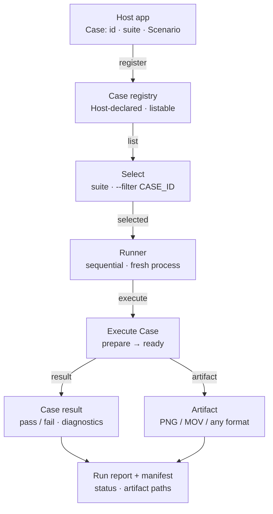

# AppStage Architecture

AppStage is a test runner for repeatable macOS app experiences. A **Case** is the unit users register, select, execute, and report. A Case may produce one or more **Artifacts**. An Artifact's format—video, image, or another output—is a result of execution, not a different kind of Case.

The organizing model follows Google Test: register test cases, select them by suite and filter, execute selected cases, then report results. AppStage keeps macOS-specific process isolation and UI control where needed; it does not need to copy Google Test's in-process execution model.

## Terms and ownership

| Term | Meaning | Owner |
|---|---|---|
| Case | Stable, user-selectable unit of work with an ID, optional suite membership, execution definition, and result | Host registration and AppStage runner |
| Suite | Ordered group of Case IDs | Case plan |
| Scenario | A reusable Host behavior definition: load, prepare, readiness, playback, and reset | Host, using AppStage scenario primitives |
| Artifact | An output produced from executing a Case, such as a video or screenshot | Artifact producer |
| Run | One invocation of the runner over the selected Cases, with configuration, results, logs, and artifacts | AppStage runner |

A Scenario may be reused by multiple Cases. For example, one Case can request a baseline view and another can request a reliability view while sharing a Scenario's deterministic data setup. That does not make either Case a “screenshot case.”

## Case lifecycle model

Current deviations sit beside the step they break; see [Current implementation and known gap](#current-implementation-and-known-gap).

1. **Register** the available Cases and their stable IDs. Registration must be queryable without opening a user-facing product window or starting a visible demo.
2. **Select** Cases from the registration catalog using the case plan, suite, include filters, and exclude filters. Pass one exact Case ID to `--filter` to run only that Case; `*` and `?` patterns can select a broader set. Filtering limits the entire run, including which Cases are launched.
3. **Execute** only selected Cases. The Host prepares deterministic state and reports readiness through the Case's execution contract. AppStage may use a fresh process per Case to isolate macOS UI state.
4. **Produce artifacts** from the executed Case. Producers receive the Case identity and capture/execution context; a Case is not duplicated or reclassified for each output format.
5. **Report** status, diagnostics, and artifact paths per Case and for the overall Run. A failure should identify the Case and lifecycle step without requiring the user to watch the UI to infer what ran.

Discovery and selection are runner operations. They must not themselves execute Cases or create visible product UI. If a Host executable must be queried to obtain dynamic registrations, that query must use a headless registration path and close before selected Case execution begins.

## Current implementation and known gap

The repository already has useful parts of this model: `StageCasePlan` provides case IDs, suites, and filters; the Host exposes Scenario and Case metadata; control protocol commands load Cases; batch workflows write manifests; and each executed Scenario can use a fresh Host process.

The implementation deviates from the model at four points:

| Step | Current behaviour |
|---|---|
| Registry | Discovery launches the Host app. In hosts that open a window for controlled launches, registration is visible. |
| Select | Filters apply after that discovery process starts, not before any Host process. |
| Runner | Recording and snapshots run through separate workflows, selected by `scenarioID` or `capturePointID`. Snapshot-specific window options live in Case metadata. |
| Execute | Control and result state identify execution by Scenario; Case identity is mostly used for selection and output naming. |

These are current implementation facts, not architecture invariants. The target is a unified Case selection and execution model with artifact producers behind it. Preserve fresh-process isolation when it benefits UI determinism, while ensuring discovery and filtering do not launch unselected Cases or show an unrelated interface.

## Module map

| Module | Responsibility |
|---|---|
| `AppStage` | Product-neutral Scenario primitives, actions, conditions, cues, playback, and launch configuration |
| `AppStageMac` | macOS window setup and visible demo cursor |
| `AppStageControl` | Host/runner control protocol, session identity, lifecycle commands, and accessibility requests |
| `AppStageCapture` | Screen/window acquisition, image framing, video recording, and media composition as artifact producers |
| `AppStageOrchestration` | Controlled Host process lifetime and UI/accessibility orchestration |
| `AppStageCLI` | Registration discovery, Case selection, execution scheduling, artifact coordination, and Run reporting |
| Host app | Case registration, deterministic data, product UI state, readiness, and Case-specific assertions |

The Host owns product behavior and domain knowledge. AppStage knows stable Case/Scenario identifiers and execution contracts; it must not know Host routes, models, or product strings.

## Design invariants

- A Case is the selection, execution, isolation, and reporting unit.
- Suite and filters apply before Case execution.
- Artifact format does not define Case identity or selection kind.
- Discovery is side-effect-free from the user's perspective: no visible product window and no Case execution.
- A Host Case starts from deterministic state and declares when its result is ready.
- Process isolation is an execution policy, not a media-format policy.
- Each Case result records its own status, diagnostics, and zero or more artifacts.
- Only the current Control Protocol and manifest schemas are supported; no older-version compatibility paths.
- Host-specific navigation and business assertions remain in the Host.
